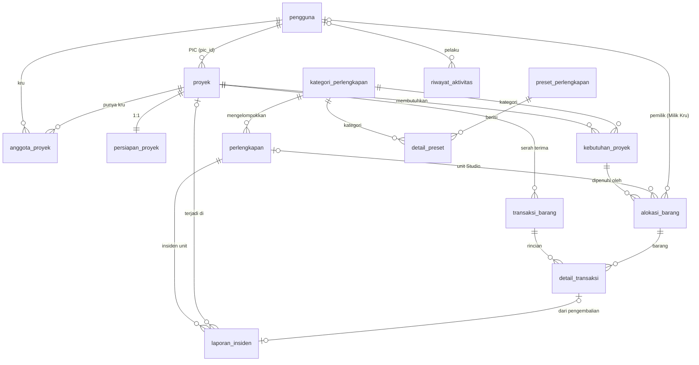

# Basis Data PhotoOps — Bahan Laporan Milestone 2

Dokumen ini adalah bahan untuk Bab 2.3, Bab 3 (bagian basis data), Bab 4 (bagian basis data), dan Lampiran G pada Laporan PBL Milestone 2. Isinya diambil dari file di folder `database/` dan dari hasil menjalankannya di PostgreSQL 17.11.

## Status implementasi

| Bagian | Status |
|---|---|
| Skema 14 tabel, data contoh, role aplikasi `photoops_si3_app`, database `photoops_si3_dev` | Sudah dibuat dan diuji |
| Uji struktur, relasi, constraint, kueri, dan pola transaksi bersamaan (di PostgreSQL) | Sudah dijalankan, hasil di Bab 4 |
| Aplikasi PHP memakai PostgreSQL | **Sebagian (hybrid).** Sudah PostgreSQL: Login & Pengguna (Sprint Backend 1), Kategori & Inventaris Studio (Sprint Backend 2), Proyek & Anggota Proyek (Sprint Backend 3A), Preset & Item Preset (Sprint Backend 3B), Kebutuhan & Alokasi termasuk catatan Rental (Sprint Backend 3C), Serah Terima barang keluar/kembali (Sprint Backend 4A), Persiapan H-1 (Sprint Backend 4B). Masih PHP Session: Insiden. Riwayat: semua aksi di PostgreSQL kecuali Insiden. Session lainnya hanya untuk login, CSRF, flash, dan form |
| Aturan yang dijaga aplikasi (bentrok jadwal unit, barang keluar sekali, kembali tidak melebihi keluar) | **Dijaga PostgreSQL lewat PHP**: bentrok jadwal unit sejak 3C; barang keluar sekali per alokasi, satu unit fisik tidak keluar di dua proyek, dan kembali tidak melebihi keluar sejak 4A (penguncian baris, diuji termasuk request bersamaan) |

Rincian integrasi Proyek & Anggota Proyek ada di bagian [Sprint Backend 3A](#sprint-backend-3a--proyek-dan-anggota-proyek), Preset di bagian [Sprint Backend 3B](#sprint-backend-3b--preset-perlengkapan-dan-item-preset), Kebutuhan & Alokasi di bagian [Sprint Backend 3C](#sprint-backend-3c--kebutuhan-proyek-dan-alokasi-barang), Serah Terima di bagian [Sprint Backend 4A](#sprint-backend-4a--serah-terima-barang), Persiapan di bagian [Sprint Backend 4B](#sprint-backend-4b--persiapan-h-1).

File utama di `database/`: `001_schema.sql` (struktur), `002_seed_demo.sql` (data contoh), `004_query_photoops.sql` (7 kueri operasional). File pendukung di `database/pendukung/`: `000_setup.sql` (admin membuat role dan database, sekali), `003_hak_akses.sql` (hak akses role aplikasi, dijalankan setelah 001 dan 002), dan `005_uji_integritas.sql` (uji). Urutan pemasangan: 000 → 001 → 002 → 003.

---

## Bab 2.3 Rancangan Basis Data

### 2.3.1 PDM

Basis data terdiri atas 14 tabel. Gambar 2.1 menampilkan tabel beserta kunci dan relasinya; versi Visual Paradigm disesuaikan dengan gambar ini.



*Gambar 2.1 PDM PhotoOps (relasi utama; kolom lengkap ada di kamus data).*

### 2.3.2 Relasi dan kardinalitas

**Tabel 2.1** Relasi antartabel

| Relasi | Kardinalitas | Kunci | Aturan hapus |
|---|---|---|---|
| pengguna → proyek (PIC) | 1 : N | `proyek.pic_id` | ditolak bila masih dirujuk |
| proyek ↔ pengguna (Kru) lewat `anggota_proyek` | M : N | `proyek_id`, `pengguna_id`, UNIQUE berdua | hapus proyek → kru ikut terhapus |
| proyek → persiapan_proyek | 1 : 1 | `persiapan_proyek.proyek_id` UNIQUE | ikut terhapus |
| proyek → kebutuhan_proyek → alokasi_barang | 1 : N : N | `kebutuhan_id` | ikut terhapus (bila belum bertransaksi) |
| kategori_perlengkapan → perlengkapan / kebutuhan / detail_preset | 1 : N | `kategori_id` | ditolak |
| preset_perlengkapan → detail_preset | 1 : N | `preset_id` | ikut terhapus |
| perlengkapan → alokasi_barang (khusus Studio) | 1 : N | `perlengkapan_id` (boleh kosong) | ditolak |
| transaksi_barang ↔ alokasi_barang lewat `detail_transaksi` | M : N | `transaksi_id`, `alokasi_id` | ditolak |
| proyek → transaksi_barang | 1 : N | `proyek_id` | ditolak (riwayat serah terima tidak boleh hilang) |
| perlengkapan → laporan_insiden | 1 : N | `perlengkapan_id` wajib | ditolak |
| proyek → laporan_insiden | 1 : N (opsional) | `proyek_id` | diisi kosong (SET NULL) |
| detail_transaksi → laporan_insiden | 1 : 0..1 | `detail_id` UNIQUE | ditolak |

Peran login (`sa`, `pi`, `us`) disimpan di `pengguna.peran`. PIC dan Kru adalah peran di dalam proyek, bukan peran login: PIC disimpan di `proyek.pic_id`, sedangkan Kru disimpan di `anggota_proyek`.

### 2.3.3 Kamus data

Tipe `INTEGER` dengan bawaan *identity* berarti nomor dibuat otomatis oleh PostgreSQL. Tanda "-" pada kolom Wajib berarti kolom boleh kosong (NULL).

**Tabel 2.2** `pengguna`

| Kolom | Tipe | Wajib | Bawaan | Batasan |
|---|---|---|---|---|
| id | INTEGER | Ya | identity | PK |
| nama | VARCHAR(60) | Ya | - | - |
| username | VARCHAR(30) | Ya | - | UNIQUE |
| email | VARCHAR(80) | Ya | - | UNIQUE |
| password_hash | VARCHAR(255) | Ya | - | - |
| peran | VARCHAR(2) | Ya | - | CHECK peran IN ('sa', 'pi', 'us') |
| jenis_anggota | VARCHAR(10) | Ya | 'Internal' | CHECK jenis_anggota IN ('Internal', 'Freelancer') |
| telepon | VARCHAR(20) | Ya | '' | - |
| status | VARCHAR(8) | Ya | 'Aktif' | CHECK status IN ('Aktif', 'Nonaktif') |

**Tabel 2.3** `kategori_perlengkapan`

| Kolom | Tipe | Wajib | Bawaan | Batasan |
|---|---|---|---|---|
| id | INTEGER | Ya | identity | PK |
| nama | VARCHAR(50) | Ya | - | UNIQUE |
| kode_awalan | VARCHAR(5) | Ya | - | UNIQUE |
| deskripsi | VARCHAR(150) | Ya | '' | - |
| nomor_terakhir | INTEGER | Ya | 0 | CHECK (nomor_terakhir >= 0) |

**Tabel 2.4** `perlengkapan`

| Kolom | Tipe | Wajib | Bawaan | Batasan |
|---|---|---|---|---|
| id | INTEGER | Ya | identity | PK |
| kode_unit | VARCHAR(12) | Ya | - | UNIQUE |
| nama | VARCHAR(60) | Ya | - | - |
| merek | VARCHAR(30) | Ya | - | - |
| kategori_id | INTEGER | Ya | - | FK → kategori_perlengkapan |
| kondisi | VARCHAR(11) | Ya | 'Baik' | CHECK kondisi IN ('Baik', 'Maintenance', 'Rusak') |
| status_aktif | VARCHAR(8) | Ya | 'Aktif' | CHECK status_aktif IN ('Aktif', 'Nonaktif') |
| catatan | VARCHAR(120) | Ya | '' | - |

**Tabel 2.5** `proyek`

| Kolom | Tipe | Wajib | Bawaan | Batasan |
|---|---|---|---|---|
| id | INTEGER | Ya | identity | PK |
| kode | VARCHAR(12) | Ya | - | UNIQUE |
| nama | VARCHAR(80) | Ya | - | - |
| klien | VARCHAR(80) | Ya | - | - |
| lokasi | VARCHAR(80) | Ya | - | - |
| mulai | TIMESTAMP | Ya | - | - |
| selesai | TIMESTAMP | Ya | - | - |
| deadline_persiapan | TIMESTAMP | Ya | - | - |
| status | VARCHAR(11) | Ya | 'Draf' | CHECK status IN ('Draf', 'Dijadwalkan', 'Berlangsung', 'Selesai', 'Dibatalkan') |
| pic_id | INTEGER | Ya | - | FK → pengguna |
| catatan | VARCHAR(300) | Ya | '' | - |
| dibuat_oleh | INTEGER | Ya | - | FK → pengguna |

Batasan tingkat tabel:
- `ck_proyek_jadwal`: CHECK (selesai >= mulai)
- `ck_proyek_deadline`: CHECK (deadline_persiapan <= mulai)

**Tabel 2.6** `anggota_proyek`

| Kolom | Tipe | Wajib | Bawaan | Batasan |
|---|---|---|---|---|
| id | INTEGER | Ya | identity | PK |
| proyek_id | INTEGER | Ya | - | FK → proyek (CASCADE) |
| pengguna_id | INTEGER | Ya | - | FK → pengguna |

Batasan tingkat tabel:
- `anggota_proyek_proyek_id_pengguna_id_key`: UNIQUE (proyek_id, pengguna_id)

**Tabel 2.7** `preset_perlengkapan`

| Kolom | Tipe | Wajib | Bawaan | Batasan |
|---|---|---|---|---|
| id | INTEGER | Ya | identity | PK |
| nama | VARCHAR(50) | Ya | - | UNIQUE |
| deskripsi | VARCHAR(160) | Ya | '' | - |
| dibuat_oleh | INTEGER | Ya | - | FK → pengguna |
| diubah_pada | TIMESTAMP | Ya | - | - |

**Tabel 2.8** `detail_preset`

| Kolom | Tipe | Wajib | Bawaan | Batasan |
|---|---|---|---|---|
| id | INTEGER | Ya | identity | PK |
| preset_id | INTEGER | Ya | - | FK → preset_perlengkapan (CASCADE) |
| nama_perlengkapan | VARCHAR(60) | Ya | - | - |
| kategori_id | INTEGER | Ya | - | FK → kategori_perlengkapan |
| jumlah | INTEGER | Ya | - | CHECK (jumlah >= 1) AND (jumlah <= 20) |

Batasan tingkat tabel:
- `detail_preset_preset_id_nama_perlengkapan_key`: UNIQUE (preset_id, nama_perlengkapan)

**Tabel 2.9** `kebutuhan_proyek`

| Kolom | Tipe | Wajib | Bawaan | Batasan |
|---|---|---|---|---|
| id | INTEGER | Ya | identity | PK |
| proyek_id | INTEGER | Ya | - | FK → proyek (CASCADE) |
| nama | VARCHAR(60) | Ya | - | - |
| acuan | VARCHAR(60) | Ya | '' | - |
| kategori_id | INTEGER | Ya | - | FK → kategori_perlengkapan |
| jumlah | INTEGER | Ya | - | CHECK (jumlah >= 1) AND (jumlah <= 50) |

**Tabel 2.10** `alokasi_barang`

| Kolom | Tipe | Wajib | Bawaan | Batasan |
|---|---|---|---|---|
| id | INTEGER | Ya | identity | PK |
| kebutuhan_id | INTEGER | Ya | - | FK → kebutuhan_proyek (CASCADE) |
| sumber | VARCHAR(9) | Ya | - | CHECK sumber IN ('Studio', 'Rental', 'Milik Kru') |
| perlengkapan_id | INTEGER | - | - | FK → perlengkapan |
| nama_barang | VARCHAR(60) | Ya | '' | - |
| vendor | VARCHAR(60) | Ya | '' | - |
| pemilik_id | INTEGER | - | - | FK → pengguna |
| jumlah | INTEGER | Ya | 1 | CHECK (jumlah >= 1) |
| tgl_mulai | DATE | Ya | - | - |
| tgl_selesai | DATE | Ya | - | - |
| status | VARCHAR(12) | Ya | 'Dikonfirmasi' | CHECK status IN ('Direncanakan', 'Dikonfirmasi', 'Dibatalkan') |
| catatan | VARCHAR(120) | Ya | '' | - |
| diperiksa | BOOLEAN | Ya | FALSE | - |
| diterima_pada | TIMESTAMP | - | - | - |
| diterima_oleh | INTEGER | - | - | FK → pengguna |
| kondisi_terima | VARCHAR(11) | - | - | CHECK kondisi_terima IN ('Baik', 'Maintenance', 'Rusak') |
| catatan_terima | VARCHAR(120) | Ya | '' | - |
| sewa_mulai | DATE | - | - | - |
| jatuh_tempo_vendor | DATE | - | - | - |
| kontak_vendor | VARCHAR(60) | Ya | '' | - |
| dikembalikan_vendor_pada | TIMESTAMP | - | - | - |
| dikembalikan_vendor_oleh | INTEGER | - | - | FK → pengguna |
| kondisi_kembali_vendor | VARCHAR(11) | - | - | CHECK kondisi_kembali_vendor IN ('Baik', 'Maintenance', 'Rusak') |
| catatan_kembali_vendor | VARCHAR(120) | Ya | '' | - |

Batasan tingkat tabel:
- `ck_alokasi_tanggal`: CHECK (tgl_selesai >= tgl_mulai)
- `ck_alokasi_sumber`: CHECK: Studio wajib perlengkapan_id dan jumlah = 1; Rental wajib nama_barang dan vendor; Milik Kru wajib nama_barang dan pemilik_id
- `ck_alokasi_diperiksa`: CHECK (diperiksa = FALSE OR status = 'Dikonfirmasi')
- `ck_alokasi_kembali_vendor`: CHECK (dikembalikan_vendor_pada IS NULL OR (diterima_pada IS NOT NULL AND dikembalikan_vendor_pada >= diterima_pada))
- `ck_alokasi_masa_sewa`: CHECK (jatuh_tempo_vendor IS NULL OR sewa_mulai IS NULL OR jatuh_tempo_vendor >= sewa_mulai)

**Tabel 2.11** `persiapan_proyek`

| Kolom | Tipe | Wajib | Bawaan | Batasan |
|---|---|---|---|---|
| id | INTEGER | Ya | identity | PK |
| proyek_id | INTEGER | Ya | - | UNIQUE; FK → proyek (CASCADE) |
| diperbarui_pada | TIMESTAMP | - | - | - |
| diperbarui_oleh | INTEGER | - | - | FK → pengguna |
| dikonfirmasi_pada | TIMESTAMP | - | - | - |
| dikonfirmasi_oleh | INTEGER | - | - | FK → pengguna |
| batal_pada | TIMESTAMP | - | - | - |
| batal_oleh | INTEGER | - | - | FK → pengguna |
| batal_otomatis | BOOLEAN | - | - | - |
| batal_alasan | TEXT | Ya | ''::text | - |
| batal_konfirmasi_pada | TIMESTAMP | - | - | - |
| batal_konfirmasi_oleh | INTEGER | - | - | FK → pengguna |

**Tabel 2.12** `transaksi_barang`

| Kolom | Tipe | Wajib | Bawaan | Batasan |
|---|---|---|---|---|
| id | INTEGER | Ya | identity | PK |
| kode | VARCHAR(12) | Ya | - | UNIQUE |
| proyek_id | INTEGER | Ya | - | FK → proyek |
| jenis | VARCHAR(7) | Ya | - | CHECK jenis IN ('Keluar', 'Kembali') |
| waktu | TIMESTAMP | Ya | - | - |
| petugas_id | INTEGER | Ya | - | FK → pengguna |
| penerima | VARCHAR(60) | Ya | '' | - |
| penerima_id | INTEGER | - | - | FK → pengguna |
| penyerah | VARCHAR(60) | Ya | '' | - |
| penyerah_id | INTEGER | - | - | FK → pengguna |
| catatan | VARCHAR(300) | Ya | '' | - |
| dicatat_pada | TIMESTAMP | - | - | - |

**Tabel 2.13** `detail_transaksi`

| Kolom | Tipe | Wajib | Bawaan | Batasan |
|---|---|---|---|---|
| id | INTEGER | Ya | identity | PK |
| transaksi_id | INTEGER | Ya | - | FK → transaksi_barang |
| alokasi_id | INTEGER | Ya | - | FK → alokasi_barang |
| kondisi | VARCHAR(11) | Ya | 'Baik' | CHECK kondisi IN ('Baik', 'Maintenance', 'Rusak') |
| jumlah | INTEGER | Ya | 1 | CHECK (jumlah >= 1) |

Batasan tingkat tabel:
- `detail_transaksi_transaksi_id_alokasi_id_kondisi_key`: UNIQUE (transaksi_id, alokasi_id, kondisi)

**Tabel 2.14** `laporan_insiden`

| Kolom | Tipe | Wajib | Bawaan | Batasan |
|---|---|---|---|---|
| id | INTEGER | Ya | identity | PK |
| kode | VARCHAR(12) | Ya | - | UNIQUE |
| perlengkapan_id | INTEGER | Ya | - | FK → perlengkapan |
| proyek_id | INTEGER | - | - | FK → proyek (SET NULL) |
| detail_id | INTEGER | - | - | UNIQUE; FK → detail_transaksi |
| jenis | VARCHAR(14) | Ya | - | CHECK jenis IN ('Rusak', 'Masalah Teknis') |
| waktu | TIMESTAMP | Ya | - | - |
| deskripsi | TEXT | Ya | - | - |
| status | VARCHAR(10) | Ya | 'Dilaporkan' | CHECK status IN ('Dilaporkan', 'Ditangani', 'Selesai') |
| pelapor_id | INTEGER | Ya | - | FK → pengguna |

**Tabel 2.15** `riwayat_aktivitas`

| Kolom | Tipe | Wajib | Bawaan | Batasan |
|---|---|---|---|---|
| id | INTEGER | Ya | identity | PK |
| waktu | TIMESTAMP | Ya | - | - |
| pengguna_id | INTEGER | - | - | FK → pengguna |
| aksi | VARCHAR(20) | Ya | - | CHECK aksi IN ('Barang Keluar', 'Pengembalian', 'Insiden', 'Alokasi', 'Rental', 'Persiapan', 'Proyek', 'Kebutuhan', 'Tim', 'Preset', 'Perlengkapan', 'Pengguna') |
| objek | VARCHAR(200) | Ya | '' | - |
| keterangan | TEXT | Ya | ''::text | - |
| lama | VARCHAR(200) | Ya | '' | - |
| baru | VARCHAR(200) | Ya | '' | - |

### 2.3.4 Normalisasi

- **1NF.** Setiap kolom berisi satu nilai. Contohnya, centang checklist yang di prototipe disimpan sebagai daftar ID dalam satu baris persiapan, kini menjadi kolom `diperiksa` per baris `alokasi_barang`.
- **2NF.** Setiap tabel memakai kunci tunggal `id`, sehingga tidak ada kolom yang hanya bergantung pada sebagian kunci. Pasangan unik seperti `(proyek_id, pengguna_id)` dijaga dengan UNIQUE.
- **3NF.** Kolom yang bisa diturunkan dari tabel lain tidak disimpan ulang:
  - `alokasi_barang` tidak menyimpan `proyek_id`, karena proyeknya diketahui lewat `kebutuhan_id`;
  - `detail_transaksi` tidak menyimpan jenis transaksi atau transaksi asal, karena keduanya diketahui lewat `transaksi_id` dan alokasinya;
  - nama PIC tidak disimpan di proyek, cukup `pic_id`.
- **Atribut turunan tidak disimpan.** Sisa barang di luar, status pemakaian unit (Tersedia/Dipinjam/Tidak Tersedia), progres checklist, ketepatan waktu persiapan, dan status sewa dihitung dengan kueri atau view saat dibutuhkan.
- **Data histori yang sengaja disimpan.** `transaksi_barang.penerima`/`penyerah` menyimpan nama saat serah terima terjadi, dan `persiapan_proyek.batal_*` menyimpan pembatalan konfirmasi terakhir. Keduanya mencatat keadaan di masa lalu, sehingga tidak boleh ikut berubah ketika data akun diubah.

### 2.3.5 Aturan integritas

**Tabel 2.16** Pembagian penjagaan aturan bisnis

| Aturan | Dijaga oleh | Cara |
|---|---|---|
| Peran login hanya sa/pi/us; status, kondisi, sumber, jenis hanya nilai yang diizinkan | Database | CHECK |
| Username, email, kode proyek/transaksi/insiden/unit tidak ganda | Database | UNIQUE |
| Satu persiapan per proyek | Database | UNIQUE `proyek_id` |
| Studio wajib unit dan jumlah 1; Rental wajib vendor; Milik Kru wajib pemilik | Database | `ck_alokasi_sumber` |
| Insiden formal hanya untuk unit Studio | Database | `laporan_insiden.perlengkapan_id` NOT NULL |
| Proyek yang sudah bertransaksi, unit yang pernah dipakai, dan pengguna yang dirujuk tidak bisa dihapus | Database | FOREIGN KEY |
| Riwayat serah terima dan log tidak bisa diubah/dihapus aplikasi | Database | Hak akses role `photoops_si3_app` |
| Unit Studio tidak boleh dipakai dua proyek pada jadwal yang beririsan | Aplikasi (dalam transaksi) | kunci baris unit + kueri Q7 |
| Satu alokasi hanya keluar satu kali | Aplikasi (dalam transaksi) | kunci baris alokasi + cek alokasi sudah ada di `v_saldo_alokasi` |
| Jumlah kembali tidak melebihi jumlah keluar | Aplikasi (dalam transaksi) | kunci baris alokasi + sisa dari `v_saldo_alokasi` (lihat Q4) |
| PIC dan Kru adalah pengguna `us` yang aktif; pemilik Milik Kru adalah anggota proyek | Aplikasi | validasi sebelum simpan |

Tiga aturan bertanda "Aplikasi (dalam transaksi)" melibatkan banyak baris sekaligus, sehingga tidak bisa ditulis sebagai CHECK. Aturan itu tidak cukup dicek dengan `if` biasa di PHP: bila dua petugas menyimpan bersamaan, keduanya bisa lolos. Karena itu aplikasi harus membuka transaksi, mengunci baris dengan `SELECT ... FOR UPDATE`, baru memeriksa dan menyimpan. Bab 4 menunjukkan uji dua sesi untuk pola ini.

---

## Bab 3 Implementasi (bagian basis data)

### 3.1 Teknologi

- PostgreSQL 17.11 dengan psql sebagai alat menjalankan skrip.
- Role `photoops_si3_app` untuk aplikasi (bukan superuser), database `photoops_si3_dev`.
- PHP 8.4 dengan PDO driver `pgsql` direncanakan untuk menghubungkan aplikasi (belum dipasang di aplikasi).

### 3.3 Basis data

**Pembuatan database.** `database/pendukung/000_setup.sql` dijalankan oleh admin untuk membuat role dan database. Sesudah itu `001_schema.sql` membuat tabel, `002_seed_demo.sql` mengisi data contoh, dan `003_hak_akses.sql` memberi hak minimum kepada role aplikasi:
- role aplikasi boleh menambah dan membaca transaksi serta log, tetapi tidak boleh mengubah atau menghapusnya;
- akun pengguna hanya bisa dihapus bila belum dirujuk data lain (ditolak FOREIGN KEY tanpa CASCADE); akun yang sudah dipakai cukup dinonaktifkan;
- password role tidak ditulis di file mana pun yang masuk Git.

**Contoh CREATE TABLE.** Tabel `alokasi_barang` (Kode 3.1) menunjukkan cara satu tabel menampung tiga sumber barang dengan satu CHECK.

```sql
CREATE TABLE alokasi_barang (
    id               INTEGER GENERATED BY DEFAULT AS IDENTITY PRIMARY KEY,
    kebutuhan_id     INTEGER     NOT NULL REFERENCES kebutuhan_proyek (id) ON DELETE CASCADE,
    sumber           VARCHAR(9)  NOT NULL CHECK (sumber IN ('Studio', 'Rental', 'Milik Kru')),
    perlengkapan_id  INTEGER     REFERENCES perlengkapan (id),
    nama_barang      VARCHAR(60) NOT NULL DEFAULT '',
    vendor           VARCHAR(60) NOT NULL DEFAULT '',
    pemilik_id       INTEGER     REFERENCES pengguna (id),
    jumlah           INTEGER     NOT NULL DEFAULT 1 CHECK (jumlah >= 1),
    -- ... kolom jadwal, status, checklist, dan siklus vendor (lihat 001_schema.sql)
    CONSTRAINT ck_alokasi_sumber CHECK (
           (sumber = 'Studio'    AND perlengkapan_id IS NOT NULL AND jumlah = 1)
        OR (sumber = 'Rental'    AND perlengkapan_id IS NULL AND nama_barang <> '' AND vendor <> '')
        OR (sumber = 'Milik Kru' AND perlengkapan_id IS NULL AND nama_barang <> '' AND pemilik_id IS NOT NULL)
    )
);
```

*Kode 3.1 Potongan tabel alokasi_barang.*

**Data uji.** Data contoh berasal dari data prototipe, ditambah sedikit data dummy untuk pengujian: siklus rental, dua konfirmasi persiapan (tepat waktu dan terlambat), serta satu pengembalian sebagian.

| Tabel | Baris | Tabel | Baris |
|---|---|---|---|
| pengguna | 7 | alokasi_barang | 41 |
| kategori_perlengkapan | 5 | persiapan_proyek | 10 |
| perlengkapan | 23 | transaksi_barang | 13 |
| proyek | 10 | detail_transaksi | 44 |
| anggota_proyek | 10 | laporan_insiden | 3 |
| preset_perlengkapan | 4 | riwayat_aktivitas | 21 |
| detail_preset | 21 | kebutuhan_proyek | 29 |

**Kueri utama.** Kueri yang disiapkan untuk fitur dicatat di Lampiran G; contoh CRUD, JOIN, agregasi, view, dan transaksi ada di G.3.

**Cara kerja PHP setelah integrasi (rencana).** Setiap modul memanggil satu koneksi PDO dengan prepared statement, sehingga input pengguna tidak pernah digabung langsung ke teks SQL. Untuk aturan yang melibatkan banyak baris, PHP menjalankan langkah dalam satu transaksi (Kode 3.2).

```php
$pdo->beginTransaction();
$pdo->prepare('SELECT id FROM alokasi_barang WHERE id = :id FOR UPDATE')->execute(['id' => $alokasi_id]);
$sisa = $pdo->prepare('SELECT sisa FROM v_saldo_alokasi WHERE alokasi_id = :id');
$sisa->execute(['id' => $alokasi_id]);
if ($jumlah > (int) $sisa->fetchColumn()) {
    $pdo->rollBack();          // ditolak: kembali melebihi sisa
} else {
    // INSERT transaksi_barang dan detail_transaksi ...
    $pdo->commit();
}
```

*Kode 3.2 Rencana pola transaksi pengembalian di PHP (belum dipasang di aplikasi).*

---

## Bab 4 Pengujian dan Evaluasi (bagian basis data)

### 4.1 Rencana pengujian

| Jenis uji | Alat | Berkas |
|---|---|---|
| Koneksi dan hak role aplikasi | PHP CLI + PDO | `tests/cek_koneksi_db.php` |
| Struktur, data contoh, relasi, constraint, aturan hapus | psql | `database/pendukung/005_uji_integritas.sql` |
| Kueri operasional (dijalankan sebagai role aplikasi) | psql | `database/004_query_photoops.sql` |
| Dua petugas mengembalikan barang yang sama bersamaan | dua sesi psql | skrip uji konkurensi (scratchpad) |
| Kinerja kueri | `EXPLAIN (ANALYZE, BUFFERS)` | Lampiran G.4 |

### 4.2 Kasus uji dan hasil

**Tabel 4.1** Kasus uji basis data (ringkasan; daftar lengkap 56 pemeriksaan ada di `database/pendukung/005_uji_integritas.sql`)

| ID | Skenario | Langkah singkat | Hasil diharapkan | Hasil aktual | Status |
|---|---|---|---|---|---|
| TC-DB-01 | Koneksi role aplikasi | `php tests/cek_koneksi_db.php` | Terhubung sebagai `photoops_si3_app`, bukan superuser | 6/6 pemeriksaan lulus | Lulus |
| TC-DB-02 | Struktur | Hitung tabel, view, function/trigger | 14 tabel, 1 view, 0 function/trigger | Sesuai | Lulus |
| TC-DB-03 | Data contoh | Hitung baris tiap tabel | Sesuai tabel data uji | Sesuai | Lulus |
| TC-DB-04 | Relasi 1:1 persiapan | Setiap proyek punya tepat satu persiapan; tambah persiapan kedua | Data konsisten; tambahan ditolak | Ditolak `persiapan_proyek_proyek_id_key` | Lulus |
| TC-DB-05 | Peran login | Ubah peran menjadi `xx` | Ditolak | Ditolak `pengguna_peran_check` | Lulus |
| TC-DB-06 | Username/email ganda | Tambah akun dengan username/email yang sudah ada | Ditolak | Ditolak `uq_pengguna_username`, `uq_pengguna_email` | Lulus |
| TC-DB-07 | Alokasi tiga sumber | Studio tanpa unit, Studio jumlah 2, Rental tanpa vendor, Milik Kru tanpa pemilik | Semua ditolak | Ditolak `ck_alokasi_sumber` (4×) | Lulus |
| TC-DB-08 | Jadwal dan deadline proyek | Selesai sebelum mulai; deadline setelah mulai | Ditolak | Ditolak `ck_proyek_jadwal`, `ck_proyek_deadline` | Lulus |
| TC-DB-09 | Siklus rental | Kembali ke vendor sebelum diterima; jatuh tempo sebelum sewa mulai | Ditolak | Ditolak `ck_alokasi_kembali_vendor`, `ck_alokasi_masa_sewa` | Lulus |
| TC-DB-10 | Insiden khusus Studio | Insiden tanpa unit | Ditolak | Ditolak (NOT NULL `perlengkapan_id`) | Lulus |
| TC-DB-11 | Hapus data yang dirujuk | Hapus proyek bertransaksi, pengguna, unit, alokasi bertransaksi | Ditolak | Ditolak FOREIGN KEY (4×) | Lulus |
| TC-DB-12 | Hapus berantai | Hapus proyek tanpa transaksi; hapus preset; hapus proyek yang punya insiden | Anak ikut terhapus; insiden tetap dengan proyek kosong | Sesuai (CASCADE, SET NULL) | Lulus |
| TC-DB-13 | Saldo barang | Bandingkan view dengan data | Keluar 25, kembali 20, sisa di alokasi 8, 25, 26, 27, 41 | Sesuai | Lulus |
| TC-DB-14 | Pengembalian sebagian | Alokasi 41: keluar 2, kembali 1, lalu kembali 1 lagi | Kembali Sebagian → Sudah Kembali, sisa tidak minus | Sesuai | Lulus |
| TC-DB-15 | Cek bentrok jadwal unit | CAM-001 untuk 7–8 Nov dan 11–12 Nov | 7–8 Nov bentrok dengan PRJ-021; 11–12 Nov kosong | Sesuai | Lulus |
| TC-DB-16 | Dua petugas bersamaan (dengan kunci) | Sesi A mengembalikan sisa terakhir; sesi B mencoba hal yang sama | B menunggu A, lalu membaca sisa 0 | B menunggu ±2 detik, sisa 0, sisa akhir 0 | Lulus |
| TC-DB-17 | Pembanding tanpa kunci | Skenario sama tanpa `FOR UPDATE` | Menunjukkan risiko | B membaca sisa 1 saat A belum selesai | Lulus (risiko terbukti) |
| TC-DB-18 | Hak akses minimum | Periksa hak role aplikasi | Tidak bisa UPDATE/DELETE transaksi dan log, tidak bisa hapus pengguna | Sesuai | Lulus |
| TC-DB-19 | Kueri operasional | Jalankan 7 kueri `004` sebagai role aplikasi | Tanpa error | 0 error; Q1 10, Q2 23, Q3 1, Q4 5, Q5 0, Q6 20, Q7 0 baris | Lulus |

**Catatan batas pengujian.**
- TC-DB-15 sampai TC-DB-17 menguji kueri dan pola transaksinya di PostgreSQL.
- Penerapannya di PHP baru diuji setelah modul Alokasi dan Serah Terima dimigrasikan.

### 4.3 Bug

Tidak ada bug basis data yang tersisa. Selama penyusunan, nama otomatis CHECK tingkat tabel (misalnya `alokasi_barang_check1`) diganti menjadi nama yang jelas (`ck_alokasi_sumber`, dan seterusnya) agar pesan galat mudah dipahami.

### Uji kueri

Hasil `EXPLAIN ANALYZE` ada di Lampiran G.4.

---

## Lampiran G. Dokumentasi Kueri Basis Data

### G.1 Skema dan indeks

Skema lengkap ada di `database/001_schema.sql` dan sama dengan kamus data di Bab 2.3. Ringkasan objeknya:
- 14 tabel, 124 kolom, 14 PRIMARY KEY, 31 FOREIGN KEY, 14 UNIQUE, dan 27 CHECK;
- 3 sequence kode dokumen (`seq_kode_proyek`, `seq_kode_transaksi`, `seq_kode_insiden`);
- 1 view (`v_saldo_alokasi`);
- tanpa function dan trigger buatan sendiri.

Indeks tambahan selain PK dan UNIQUE:

```sql
CREATE INDEX idx_kebutuhan_proyek     ON kebutuhan_proyek (proyek_id);
CREATE INDEX idx_alokasi_kebutuhan    ON alokasi_barang (kebutuhan_id);
CREATE INDEX idx_alokasi_perlengkapan ON alokasi_barang (perlengkapan_id);
CREATE INDEX idx_detail_alokasi       ON detail_transaksi (alokasi_id);
CREATE INDEX idx_transaksi_proyek     ON transaksi_barang (proyek_id);
CREATE INDEX idx_riwayat_waktu        ON riwayat_aktivitas (waktu);
```

Setiap indeks dipasang pada kolom yang sering dipakai untuk JOIN atau filter, misalnya mencari kebutuhan suatu proyek atau alokasi sebuah unit. PostgreSQL tidak membuat indeks untuk FOREIGN KEY secara otomatis.

### G.2 Daftar kueri

**Tabel G.1** Kueri operasional pada `004_query_photoops.sql`

| No | Fungsi di aplikasi | Tabel yang dipakai | Jenis |
|---|---|---|---|
| Q1 | Daftar proyek beserta PIC | proyek, pengguna | Tampil (JOIN) |
| Q2 | Perlengkapan Studio beserta kategorinya | perlengkapan, kategori_perlengkapan | Tampil (JOIN) |
| Q3 | Kebutuhan proyek aktif yang belum terpenuhi | kebutuhan_proyek, proyek, alokasi_barang | Hitung (SUM, GROUP BY, HAVING) |
| Q4 | Barang yang belum kembali dari proyek | v_saldo_alokasi, alokasi_barang, proyek, perlengkapan | Tampil (view) |
| Q5 | Rental yang melewati jatuh tempo vendor | alokasi_barang, kebutuhan_proyek, proyek | Tampil (operasi tanggal) |
| Q6 | Riwayat aktivitas terbaru | riwayat_aktivitas, pengguna | Tampil (LEFT JOIN) |
| Q7 | Cek bentrok jadwal unit Studio sebelum dialokasikan | alokasi_barang, kebutuhan_proyek, proyek, v_saldo_alokasi | Tampil (subquery) |

### G.3 Kueri dan fungsinya

**Q1. Daftar proyek beserta PIC.** JOIN menghubungkan `proyek.pic_id` dengan `pengguna.id`, sehingga nama PIC tidak perlu disimpan berulang di tabel proyek.

```sql
SELECT p.kode, p.nama, p.status, p.mulai, pic.nama AS pic
FROM proyek p
JOIN pengguna pic ON pic.id = p.pic_id
ORDER BY p.mulai DESC;
```

Hasil: 10 baris, misalnya `PRJ-021 | Wedding Arunika & Dimas | Dijadwalkan | Rizky Pratama`.

**Q3. Kebutuhan proyek aktif yang belum terpenuhi.**
- SUM menjumlahkan barang yang sudah dialokasikan untuk tiap kebutuhan.
- Syarat `status <> 'Dibatalkan'` ditaruh di `ON`, bukan di `WHERE`, supaya kebutuhan yang belum punya alokasi tetap tampil dengan nilai 0.
- `WHERE` memilih proyek yang masih aktif sebelum dikelompokkan, lalu `HAVING` menyaring kebutuhan yang jumlahnya masih kurang.

```sql
SELECT p.kode, k.nama AS kebutuhan, k.jumlah AS dibutuhkan,
       COALESCE(SUM(a.jumlah), 0) AS dialokasikan
FROM kebutuhan_proyek k
JOIN proyek p              ON p.id = k.proyek_id
LEFT JOIN alokasi_barang a ON a.kebutuhan_id = k.id
                          AND a.status <> 'Dibatalkan'
WHERE p.status NOT IN ('Selesai', 'Dibatalkan')
GROUP BY p.kode, k.id, k.nama, k.jumlah
HAVING COALESCE(SUM(a.jumlah), 0) < k.jumlah
ORDER BY p.kode;
```

Hasil: 1 baris, `PRJ-021 | Lighting LED | 1 | 0`. Satu-satunya alokasi untuk kebutuhan itu (LGT-001) dibatalkan karena unitnya masuk maintenance.

**Q4. Barang yang belum kembali.** Sisa barang di luar tidak disimpan sebagai kolom karena selalu bisa dihitung dari transaksi. View `v_saldo_alokasi` melakukan perhitungan itu dalam tiga langkah (CTE):
1. `keluar` mengambil barang yang keluar per alokasi;
2. `kembali` menjumlahkan barang yang sudah kembali per alokasi;
3. keduanya digabung, dan `sisa = jumlah_keluar - jumlah_kembali`.

Q4 cukup membaca view itu.

```sql
SELECT p.kode AS proyek, COALESCE(pl.kode_unit, a.nama_barang) AS barang,
       s.jumlah_keluar, s.jumlah_kembali, s.sisa, s.status_kembali
FROM v_saldo_alokasi s
JOIN alokasi_barang a     ON a.id = s.alokasi_id
JOIN proyek p             ON p.id = s.proyek_id
LEFT JOIN perlengkapan pl ON pl.id = a.perlengkapan_id
WHERE s.sisa > 0
ORDER BY p.kode;
```

| proyek | barang | keluar | kembali | sisa | status_kembali |
|---|---|---|---|---|---|
| PRJ-020 | CAM-003 | 1 | 0 | 1 | Belum Kembali |
| PRJ-025 | LGT-002 | 1 | 0 | 1 | Belum Kembali |
| PRJ-025 | LGT-003 | 1 | 0 | 1 | Belum Kembali |
| PRJ-025 | CAM-005 | 1 | 0 | 1 | Belum Kembali |
| PRJ-025 | SD Card 64GB ×2 | 2 | 1 | 1 | Kembali Sebagian |

Saat mencatat pengembalian, PHP membaca sisa dari view yang sama setelah mengunci baris alokasi (`FOR UPDATE`). Pengembalian hanya disimpan bila jumlahnya ≤ sisa.

**Q5. Rental yang melewati jatuh tempo vendor.** Selisih dua nilai `DATE` menghasilkan jumlah hari keterlambatan. Per 2026-11-07 hasilnya kosong. Dengan tanggal 2026-11-10, hasilnya Sony FX3 PRJ-020 (jatuh tempo 2026-11-09), terlambat 1 hari.

**Q7. Cek bentrok jadwal unit Studio.** Dua rentang tanggal beririsan bila `mulai_lama <= selesai_baru` dan `selesai_lama >= mulai_baru`. Alokasi yang dibatalkan atau barangnya sudah kembali penuh diabaikan. Hasil kosong berarti unit boleh dialokasikan; pada contoh, CAM-001 untuk 11–12 Nov kosong. PHP menjalankan kueri ini di dalam transaksi setelah mengunci baris unit, agar dua petugas tidak mengalokasikan unit yang sama bersamaan.

### G.4 Pengujian dengan EXPLAIN ANALYZE

Dijalankan di `photoops_si3_dev`, PostgreSQL 17.11, dengan data contoh, dengan menambahkan `EXPLAIN (ANALYZE, BUFFERS)` di depan kueri.

**Tabel G.2** Hasil EXPLAIN (ANALYZE, BUFFERS)

| Kueri | Jumlah baris data uji | Jenis scan | Execution time | Catatan |
|---|---|---|---|---|
| Q1 Daftar proyek + PIC | proyek 10, pengguna 7 | Seq Scan + Hash Join | 0,136 ms | Tabel kecil, Seq Scan paling murah |
| Q3 Kebutuhan belum terpenuhi | kebutuhan 29, alokasi 41 | Seq Scan + HashAggregate | 0,377 ms | Cukup untuk ukuran data sekarang |
| Q4 Barang belum kembali | detail 44, transaksi 13 | Index Scan (PK) + Bitmap Index Scan (UNIQUE detail) | 0,539 ms | Indeks dipakai saat mencocokkan detail dengan transaksi |

Cara membaca hasilnya:
- **Seq Scan:** membaca semua baris tabel. Pada tabel kecil seperti ini justru paling cepat, sehingga PostgreSQL memilihnya walaupun ada indeks.
- **Index Scan / Bitmap Index Scan:** memakai indeks untuk langsung menuju baris yang dicari.
- **Execution time:** waktu nyata kueri dijalankan. Angkanya sedikit berbeda di setiap run.

Pengujian dengan data besar (misalnya 10.000 baris) belum dilakukan. Tangkapan layar untuk laporan diambil dari psql atau pgAdmin masing-masing.

---

## Sprint Backend 3A — Proyek dan Anggota Proyek

### Ruang lingkup

Data proyek, PIC, dan kru dibaca dan ditulis di PostgreSQL (tabel `proyek`, `anggota_proyek`, `persiapan_proyek`, `riwayat_aktivitas`). Skema tidak diubah. Modul yang masih memakai PHP Session (kebutuhan, alokasi, persiapan, serah terima, insiden) tetap menyimpan `proyek_id` dan membaca proyek lewat `semua_proyek()` / `cari_proyek()`, seperti unit Studio pada Sprint Backend 2.

### Aturan yang diterapkan

| Aturan | Penerapan |
|---|---|
| PIC disimpan di `proyek.pic_id`, kru di `anggota_proyek` | `peran_di_proyek()` mengembalikan `PIC` bila pengguna = `pic_id`, `Kru` bila ada baris `anggota_proyek`. Daftar tim menampilkan PIC sebagai baris pertama (id 0, bukan baris tabel) |
| PIC dan kru harus User/Kru (`us`) yang Aktif | Divalidasi di form, lalu dikunci di transaksi dengan `SELECT ... FOR SHARE` pada baris `pengguna` |
| Ganti PIC | Satu transaksi: `UPDATE proyek`, PIC lama dimasukkan sebagai kru (`ON CONFLICT DO NOTHING`), baris kru milik PIC baru dihapus, riwayat Tim "PIC diganti" |
| Kru tidak ganda | `UNIQUE (proyek_id, pengguna_id)` + `INSERT ... ON CONFLICT DO NOTHING RETURNING id` |
| Perubahan tim dan PIC tidak bertabrakan | Setiap operasi mengunci baris proyek dengan `SELECT ... FOR UPDATE` |
| Kode proyek unik | `nextval('seq_kode_proyek')` → `PRJ-026`, dst. Nomor tidak dipakai ulang |
| Persiapan 1:1 | Baris `persiapan_proyek` dibuat dalam transaksi yang sama dengan proyek |
| Proyek Selesai/Dibatalkan | Tim tidak bisa diubah (dicek di backend, bukan hanya tombol yang disembunyikan) |
| Riwayat | Aksi `Proyek` dan `Tim` ditulis ke `riwayat_aktivitas` dalam transaksi yang sama. Bila pencatatan gagal, perubahan ikut di-ROLLBACK |
| Hapus permanen proyek | Ditunda (`HAPUS_PROYEK_TERSEDIA = false`) selama turunan proyek masih di session per browser. Gunakan status Dibatalkan |
| Panjang teks | Nama/klien/lokasi ≤ 80, catatan ≤ 300 (sama dengan kolom), sehingga galat tampil di form, bukan halaman 503 |

### Deadline persiapan dan penilaian Tepat Waktu/Terlambat

Jam aplikasi `sekarang()` memakai tanggal demo `HARI_INI` ditambah jam nyata, sehingga urutan waktu tidak bisa diandalkan antar hari. Karena itu log session dan log PostgreSQL **tidak dibandingkan menurut waktu**:

1. Saat persiapan dikonfirmasi, entri log konfirmasi menyimpan snapshot `deadline` yang berlaku saat itu. Penilaian memakai snapshot ini.
2. Konfirmasi lama tanpa snapshot memakai nilai `lama` dari perubahan deadline pertama sesudahnya (log session menurut id; log PostgreSQL yang seluruhnya dibuat setelah migrasi 3A).
3. Status "Lewat deadline" pada halaman proyek selalu memakai deadline terbaru.

Log Proyek dan Tim di PostgreSQL memakai `sekarang()` agar sejajar dengan log Persiapan di session pada halaman Riwayat. Mekanisme tanggal global (`HARI_INI`) tidak diubah.

### Migrasi dari Session

Seed PostgreSQL dan seed session memakai id proyek 1–10 dan id kru yang sama, jadi tidak ada data yang dipindahkan. `VERSI_DATA` dinaikkan menjadi 4: setiap session lama di-seed ulang otomatis agar kebutuhan/alokasi session tidak menunjuk proyek buatan session (id 11 dst.). Proyek yang pernah dibuat di session sebelum migrasi tidak terbawa.

### Pengujian

| Uji | Perintah | Hasil |
|---|---|---|
| Integrasi 3A (Q01–Q20, 70 pemeriksaan) | `PHOTOOPS_DB_NAME=photoops_si3_test php tests/uji_proyek.php` | 70 lulus, 0 gagal (dijalankan dua kali berturut-turut) |
| Sintaks PHP | `php -l` semua berkas | 0 galat |
| Regresi Inventaris | `PHOTOOPS_DB_NAME=photoops_si3_test php tests/uji_inventaris.php` | **Belum dijalankan.** Uji berhenti sendiri karena database uji tidak lagi berisi 23 unit seed; perlu dibuat ulang dari 001 + 002 + 003 oleh admin PostgreSQL |

`uji_proyek.php` tidak mensyaratkan database uji yang baru dibuat ulang: proyek uji (nama berawalan `UJI3A`) dibuat dan dihapus sendiri, proyek contoh 1–10 hanya dibaca setelah dicek masih sesuai seed. Cakupan: buat/ubah proyek, kode dari sequence saat dibuat bersamaan, validasi, ganti PIC, tambah/lepas kru (termasuk bersamaan), hak akses tiga peran, CSRF, hapus ditunda, rollback, penilaian deadline, kompatibilitas modul session, dan session lama.

### Keterbatasan hybrid yang tersisa

- Kebutuhan, alokasi, persiapan, dan serah terima proyek masih per browser sampai modul tersebut dimigrasikan.
- Pemeriksaan "kru masih membawa barang Milik Kru" saat kru dilepas hanya melihat alokasi di browser yang sedang dipakai.
- Mengubah tanggal proyek tidak memperbarui tanggal alokasi yang sudah ada (perilaku lama, ditangani saat migrasi Alokasi).
- Log Pengguna dan Perlengkapan memakai tanggal nyata, sedangkan log Proyek/Tim/session memakai tanggal demo; urutan di halaman Riwayat antar kedua kelompok ini belum seragam.

## Sprint Backend 3B — Preset Perlengkapan dan Item Preset

### Ruang lingkup

Preset dan isinya dibaca dan ditulis di PostgreSQL (tabel `preset_perlengkapan`, `detail_preset`, `riwayat_aktivitas`) lewat `data/logic_preset.php`. Skema tidak diubah. Item preset merujuk ke **nama model** (teks) dan kategori, bukan ke unit tertentu. "Isi dari preset" di detail proyek menyalin item preset menjadi kebutuhan proyek (kebutuhan masih di session); tidak ada foreign key dari kebutuhan ke preset.

### Aturan yang diterapkan

| Aturan | Penerapan |
|---|---|
| Hak akses | Lihat dan kelola: Super Admin dan Petugas Inventaris (`preset.lihat`, `preset.kelola`). User/Kru ditolak, termasuk lewat POST langsung. Semua POST memakai CSRF |
| Nama preset unik, tanpa membedakan huruf besar/kecil | Dicek dengan `LOWER(nama)` di dalam transaksi setelah `LOCK TABLE preset_perlengkapan IN SHARE ROW EXCLUSIVE MODE`, sehingga dua browser tidak bisa menyimpan nama yang sama bersamaan. `UNIQUE (nama)` di skema tetap menjadi pengaman terakhir |
| Panjang teks | Nama 3–50, deskripsi ≤ 160, nama model 2–60 (sama dengan kolom) |
| Jumlah item | Bilangan bulat 1–20 (`CHECK` di `detail_preset`); `0`, negatif, desimal, dan teks ditolak di form |
| Kategori item | Harus ada di `kategori_perlengkapan`. Model yang ada di Inventaris Studio otomatis memakai kategori unitnya |
| Model tidak ganda dalam satu preset | Dicek `LOWER(nama_perlengkapan)` setelah baris preset dikunci (`SELECT ... FOR UPDATE`). Model yang sama boleh ada di preset lain (`UNIQUE (preset_id, nama_perlengkapan)`) |
| Item milik preset yang benar | Preset tujuan dikirim form (`preset_id`). Preset yang tidak ada atau item milik preset lain ditolak, tidak lagi jatuh ke preset yang tampil pertama |
| Transaksi | Item, `diubah_pada` preset, dan riwayat `Preset` tersimpan dalam satu transaksi. Bila pencatatan riwayat gagal, semuanya di-ROLLBACK |
| Hapus preset | Diizinkan (permanen). Itemnya ikut terhapus (`ON DELETE CASCADE`); kebutuhan proyek yang dulu diisi dari preset tetap utuh karena berupa salinan |
| Pembuat preset | `dibuat_oleh` diisi pengguna yang membuat, ditampilkan di detail preset. Akun pembuat preset tidak bisa dihapus (sudah dicek di Manajemen Pengguna) |

### Pemeriksaan stok preset

Kolom "Stok studio" dihitung dari unit Studio **aktif** di PostgreSQL per nama model (`total`), dan unit yang **tersedia hari ini** (`tersedia`: kondisi Baik dan tidak sedang keluar). Status "sedang keluar" masih dibaca dari alokasi/serah terima di session browser yang sedang dipakai. Angka ini **bukan** ketersediaan pada jadwal proyek tertentu: bentrok jadwal tetap diperiksa per unit saat alokasi (`cek_unit_untuk_proyek`) dan baru akan akurat lintas browser setelah Alokasi dimigrasikan (Sprint 3C). Halaman Preset menuliskan hal ini di bawah tabel.

### Migrasi dari Session

Seed PostgreSQL dan seed session memakai preset 1–4 dan item 1–21 yang sama. Tidak ada data session yang menyimpan id preset, sehingga `VERSI_DATA` **tidak** dinaikkan; salinan `preset`/`detail_preset` di session cukup dibuang di `bootstrap.php`. Preset yang pernah dibuat di session sebuah browser sebelum 3B tidak terbawa (kebutuhan yang dulu diisi darinya tetap ada).

### Pengujian

| Uji | Perintah | Hasil |
|---|---|---|
| Integrasi 3B (T01–T18, 75 pemeriksaan) | `PHOTOOPS_DB_NAME=photoops_si3_test php tests/uji_preset.php` | 75 lulus, 0 gagal (dua kali berturut-turut) |
| Regresi 3A | `PHOTOOPS_DB_NAME=photoops_si3_test php tests/uji_proyek.php` | 70 lulus, 0 gagal |
| Sintaks PHP | `php -l` semua berkas | 0 galat |
| Regresi Inventaris | `PHOTOOPS_DB_NAME=photoops_si3_test php tests/uji_inventaris.php` | **Belum dijalankan** (alasan sama dengan 3A: database uji perlu dibuat ulang dari 001 + 002 + 003) |

`uji_preset.php` membuat dan menghapus sendiri preset berawalan `UJI3B`; preset contoh 1–4 hanya dibaca setelah dicek masih sesuai seed. Cakupan: baca dari PostgreSQL, tambah/ubah/hapus preset dan item, validasi jumlah dan relasi, duplikasi (termasuk dua proses bersamaan), rollback, hak akses, CSRF, lintas browser, isi kebutuhan dari preset, stok, session lama, riwayat, tampilan halaman, login, dan halaman ketiga peran.

### Keterbatasan hybrid yang tersisa

- Ketersediaan stok di halaman Preset bergantung pada alokasi di session browser yang sedang dipakai, dan belum memperhitungkan jadwal (Sprint 3C).
- Kebutuhan hasil "Isi dari preset" masih tersimpan per browser sampai Kebutuhan dimigrasikan. *(Diselesaikan di Sprint 3C.)*

## Sprint Backend 3C — Kebutuhan Proyek dan Alokasi Barang

### Ruang lingkup

Kebutuhan dan alokasi (Studio, Rental, Milik Kru) dibaca dan ditulis di PostgreSQL (`kebutuhan_proyek`, `alokasi_barang`, `riwayat_aktivitas`) lewat `data/logic_alokasi.php`. Kolom Rental pada `alokasi_barang` (`diterima_*`, `sewa_mulai`, `jatuh_tempo_vendor`, `kontak_vendor`, `dikembalikan_vendor_*`) ikut ditulis di PostgreSQL karena merupakan bagian baris alokasi; alur halaman Barang eksternal tidak diubah. Skema tidak diubah. Persiapan (checklist id alokasi dan konfirmasi) serta Serah Terima tetap di PHP Session dan merujuk id alokasi PostgreSQL.

### Aturan dan penguncian

| Aturan | Penerapan |
|---|---|
| Urutan kunci | Setiap perubahan kebutuhan/alokasi mengunci baris `proyek` (`FOR UPDATE`) lebih dulu, lalu baris `kebutuhan_proyek`, lalu (Studio) baris `perlengkapan`. Urutan yang sama di semua fungsi mencegah deadlock |
| Tidak ada double booking unit | Alokasi Studio mengunci baris unit, lalu mencari alokasi lain unit itu yang bukan Dibatalkan dan jadwalnya bertabrakan (`tgl_mulai <= selesai AND tgl_selesai >= mulai`) atau sudah ada di proyek yang sama. Request kedua menunggu kunci, lalu melihat alokasi pertama dan ditolak. Bukan "SELECT lalu INSERT" tanpa kunci |
| Jadwal alokasi | `tgl_mulai` = tanggal batas persiapan (atau mulai acara bila lebih awal), `tgl_selesai` = tanggal selesai acara, dihitung dari baris proyek yang sudah dikunci |
| Unit layak | Unit harus Aktif, berkondisi Baik, dan sekategori dengan kebutuhannya (dicek ulang di transaksi) |
| Tidak melebihi kebutuhan | Jumlah unit terisi (Studio = 1, Rental/Milik Kru = `jumlah`, alokasi Dibatalkan tidak dihitung) dihitung ulang setelah kebutuhan dikunci |
| Milik Kru | Pemilik harus PIC atau kru proyek (dicek di transaksi). Kru yang masih membawa barang Milik Kru tidak bisa dilepas dari tim — kini berlaku untuk semua browser |
| Kebutuhan | Jumlah 1–50, nama/acuan ≤ 60. Jumlah tidak bisa di bawah unit terisi; kategori tidak bisa diubah bila ada alokasi aktif atau serah terima; kebutuhan dengan alokasi aktif atau serah terima tidak bisa dihapus (alokasi Dibatalkan ikut terhapus lewat CASCADE) |
| Isi dari preset | Item preset disalin dalam satu transaksi; baris preset dikunci `FOR SHARE` agar tidak terhapus di tengah proses |
| Konfirmasi/batal/hapus alokasi | Alokasi yang sudah punya serah terima (session browser ini, atau `detail_transaksi` di PostgreSQL) atau Rental yang sudah diterima dari vendor dikunci |
| Catatan Rental | `UPDATE ... WHERE` memuat syarat keadaan (misalnya `diterima_pada IS NULL`), sehingga penerimaan/pengembalian/perpanjangan dari dua browser tidak tercatat dua kali |
| Riwayat | Aksi Kebutuhan, Alokasi, Rental ditulis ke `riwayat_aktivitas` dalam transaksi yang sama; bila gagal, seluruh perubahan di-ROLLBACK |

**Perubahan perilaku:** pemeriksaan bentrok kini memperhitungkan semua alokasi unit yang bukan Dibatalkan, termasuk yang barangnya sudah kembali lebih awal. Status "sudah kembali" masih per browser (Serah Terima di session), sehingga tidak dipakai untuk membebaskan jadwal; hasilnya sama di semua browser.

### Migrasi dari Session

Seed PostgreSQL dan seed session memakai kebutuhan 1–28 dan alokasi 1–40 yang sama. Seed PostgreSQL punya tambahan kebutuhan #29 dan alokasi #41 (Milik Kru PRJ-025, keluar 2 kembali 1); seed session diselaraskan (centang persiapan #41, TRX-044/045, dan riwayatnya). `VERSI_DATA` dinaikkan menjadi 5: checklist persiapan dan serah terima di session menyimpan id alokasi, dan session lama bisa berisi alokasi buatan session (id 41 dst.) yang di PostgreSQL adalah alokasi lain, jadi setiap session di-seed ulang. Kebutuhan, alokasi, checklist, dan serah terima yang pernah dibuat di session sebelum 3C tidak terbawa.

### Pengujian

| Uji | Perintah | Hasil |
|---|---|---|
| Integrasi 3C (K01–K18, 90 pemeriksaan) | `PHOTOOPS_DB_NAME=photoops_si3_test php tests/uji_kebutuhan_alokasi.php` | 90 lulus, 0 gagal (dua kali berturut-turut) |
| Regresi 3A | `PHOTOOPS_DB_NAME=photoops_si3_test php tests/uji_proyek.php` | 70 lulus, 0 gagal |
| Regresi 3B | `PHOTOOPS_DB_NAME=photoops_si3_test php tests/uji_preset.php` | 75 lulus, 0 gagal |
| Sintaks PHP | `php -l` semua berkas | 0 galat |
| Regresi Inventaris | `PHOTOOPS_DB_NAME=photoops_si3_test php tests/uji_inventaris.php` | **Belum dijalankan** (database uji perlu dibuat ulang dari 001 + 002 + 003) |

`uji_kebutuhan_alokasi.php` membuat dan menghapus sendiri proyek berawalan `UJI3C` (jadwal Januari–Februari 2027); kebutuhan 1–29 dan alokasi 1–41 contoh hanya dibaca setelah dicek masih sesuai seed. Cakupan: CRUD kebutuhan, isi dari preset, validasi, alokasi tiga sumber, bentrok jadwal, dua request bersamaan (unit yang sama dan sisa kebutuhan yang sama), konfirmasi/batal/hapus, catatan Rental, rollback tujuh operasi, hak akses, CSRF, lintas browser, lepas kru, persiapan → serah terima barang keluar, dashboard, dan session lama. Uji 3A dan 3B disesuaikan karena kebutuhan/alokasi tidak lagi di session.

### Keterbatasan hybrid yang tersisa

- **Serah Terima masih per browser.** Status "keluar/kembali" dan kunci "sudah tercatat di serah terima" hanya diketahui browser yang mencatatnya. Browser lain (yang persiapannya tidak dikonfirmasi di session-nya) masih bisa membatalkan atau menghapus alokasi yang secara fisik sudah keluar; di browser pencatat, baris serah terima itu lalu tampil "Alokasi dihapus". Penjaga yang ada: kunci untuk data serah terima di PostgreSQL (data contoh) dan bentrok jadwal yang tetap dicek di PostgreSQL. Selesai bila Serah Terima dimigrasikan (Sprint 4). *(Diselesaikan di Sprint 4A.)*
- **Persiapan masih per browser.** Checklist dan konfirmasi persiapan, termasuk kunci "persiapan sudah dikonfirmasi" yang menahan perubahan kebutuhan/alokasi, hanya berlaku di browser yang mengonfirmasi. Perubahan alokasi dari browser lain tidak mencabut konfirmasi di browser itu sampai halamannya memuat ulang dan menghitung syarat.
- **Status unit "Dipinjam" dan catatan "masih keluar di …"** di Inventaris/dialog alokasi berasal dari serah terima browser yang sedang dipakai. *(Diselesaikan di Sprint 4A.)*
- Mengubah tanggal proyek tetap tidak memperbarui tanggal alokasi yang sudah ada.

## Sprint Backend 4A — Serah Terima Barang

### Ruang lingkup

Barang keluar dan pengembalian (Studio, Rental, Milik Kru) dibaca dan ditulis di PostgreSQL (`transaksi_barang`, `detail_transaksi`, view `v_saldo_alokasi`, `seq_kode_transaksi`, `riwayat_aktivitas`). Skema dan hak akses tidak diubah. Alur halaman Serah Terima (dialog Barang Keluar, dialog Pengembalian, daftar transaksi) tidak diubah. Persiapan dan Insiden tetap di PHP Session.

### Aturan dan penguncian

| Aturan | Penerapan |
|---|---|
| Sumber data | Status keluar/kembali, saldo, "Dipinjam" di Inventaris, kunci alokasi, dan grafik tren dibaca dari tabel transaksi PostgreSQL, sehingga sama di semua browser |
| Urutan kunci | Sama dengan 3C: proyek (`FOR UPDATE`) → alokasi (`FOR UPDATE`, urut id) → unit perlengkapan. Barang keluar, pengembalian, dan pembatalan/hapus alokasi pada proyek yang sama berjalan bergantian |
| Barang keluar | Seluruh jumlah alokasi sekaligus, satu kali per alokasi. Di dalam kunci dicek ulang: alokasi Dikonfirmasi dan belum pernah keluar, jumlah sesuai, penerima anggota tim yang aktif, unit Studio Aktif/Baik dan tidak sedang keluar di proyek lain, Rental sudah diterima dan belum dikembalikan ke vendor |
| Pengembalian | Boleh bertahap dan dipecah per kondisi (satu baris `detail_transaksi` per alokasi per kondisi). Saldo dihitung ulang dari `v_saldo_alokasi` di dalam kunci: barang yang belum keluar, jumlah melebihi sisa, pengembalian ganda, dan waktu sebelum keluar/pengembalian terakhir ditolak |
| Kondisi barang | Kondisi dan catatan tersimpan di transaksi. Unit Studio yang kembali Rusak/Maintenance diubah kondisinya di transaksi yang sama; insiden otomatis (session) menunjuk `detail_transaksi.id` PostgreSQL. Barang eksternal hanya dicatat kondisinya, inventaris studio tidak berubah |
| Alokasi yang sudah keluar | Tidak bisa dibatalkan/dihapus (dicek di dalam kunci oleh `ubah_status_alokasi()`), kebutuhannya tidak bisa dihapus, kru pemilik barang tidak bisa dilepas. Pengaman terakhir: `detail_transaksi.alokasi_id` FOREIGN KEY tanpa CASCADE |
| Rental | Pengembalian ke vendor ditolak selama barang masih tercatat di proyek (`NOT EXISTS ... v_saldo_alokasi ... sisa > 0` di dalam UPDATE setelah baris alokasi dikunci). Data vendor/penerimaan tidak diubah oleh serah terima |
| Riwayat | Aksi Barang Keluar dan Pengembalian ditulis ke `riwayat_aktivitas` dalam transaksi yang sama (waktu `sekarang()`, sama dengan log lain). Log contoh yang sama di session tidak ditampilkan lagi sehingga tidak ganda |
| Tanggal selesai acara | Tetap hanya informasi jadwal, bukan batas wajib pengembalian |

**Persiapan sebagai syarat barang keluar:** gerbang di halaman (`gerbang_keluar()`) tetap memakai konfirmasi persiapan di session browser yang mencatat. Gerbang ini tidak bisa terlewati karena perbedaan session: browser yang belum mengonfirmasi persiapan ditolak, dan setelah barang keluar browser lain membaca status keluar dari PostgreSQL ("data lama") lalu tetap menolak. Integritas data (tidak keluar ganda, tidak melebihi alokasi, unit tidak di dua proyek) dijaga di PostgreSQL terlepas dari session. Tabel `persiapan_proyek` sudah punya kolom `dikonfirmasi_*`, tetapi memindahkan konfirmasi ke sana adalah migrasi Persiapan dan tidak dilakukan di sprint ini.

### Migrasi dari Session

Seed PostgreSQL dan seed session berisi transaksi TRX-030 s.d. TRX-045 yang sama. `VERSI_DATA` dinaikkan menjadi 6: session lama bisa berisi transaksi buatan session (TRX-046 dst.) beserta insiden dan konfirmasi persiapan yang merujuknya, jadi setiap session di-seed ulang. Transaksi, insiden, checklist, dan konfirmasi persiapan yang pernah dibuat di session sebelum 4A tidak terbawa.

### Pengujian

| Uji | Perintah | Hasil |
|---|---|---|
| Integrasi 4A (S01–S20, 53 pemeriksaan) | `PHOTOOPS_DB_NAME=photoops_si3_test php tests/uji_serah_terima.php` | 53 lulus, 0 gagal (dua kali berturut-turut) |
| Regresi 3C | `PHOTOOPS_DB_NAME=photoops_si3_test php tests/uji_kebutuhan_alokasi.php` | 90 lulus, 0 gagal |
| Regresi 3A | `PHOTOOPS_DB_NAME=photoops_si3_test php tests/uji_proyek.php` | 70 lulus, 0 gagal |
| Regresi 3B | `PHOTOOPS_DB_NAME=photoops_si3_test php tests/uji_preset.php` | 75 lulus, 0 gagal |
| Sintaks PHP | `php -l` semua berkas | 0 galat |
| Regresi Inventaris | `PHOTOOPS_DB_NAME=photoops_si3_test php tests/uji_inventaris.php` | **Belum dijalankan** (database uji perlu dibuat ulang dari 001 + 002 + 003). Skenario E01 lama ("bukti risiko" tanpa transaksi) dihapus karena kini akan menulis transaksi permanen ke data contoh |

Transaksi serah terima tidak bisa dihapus oleh aplikasi (hanya ditambah), sehingga proyek uji yang bertransaksi tidak bisa dihapus. `tests/bantu_bersihkan.php` mengarsipkannya: sisa barang dicatat kembali, alokasinya dibatalkan, proyek diganti nama `ARSIP-UJI <kode>` berstatus Dibatalkan. Setiap putaran uji 4A/3C menambah beberapa proyek arsip ini di database uji (bukan di database development).

### Keterbatasan yang tersisa

- **Persiapan masih per browser** (checklist, konfirmasi, kunci "persiapan sudah dikonfirmasi"). Browser lain yang belum mengonfirmasi tidak bisa mencatat barang keluar, tetapi juga tidak ikut terkunci saat mengubah kebutuhan/alokasi yang belum keluar. *(Diselesaikan di Sprint 4B.)*
- **Insiden masih per browser.** Insiden otomatis dari pengembalian Rusak/Maintenance hanya tersimpan di session browser yang mencatat (kondisi unit dan transaksinya sudah di PostgreSQL); kode INS dapat sama di dua browser.
- Mengubah tanggal proyek tetap tidak memperbarui tanggal alokasi yang sudah ada.

## Sprint Backend 4B — Persiapan H-1

### Ruang lingkup

Checklist, konfirmasi, pembatalan konfirmasi, dan riwayat Persiapan dibaca dan ditulis di PostgreSQL lewat `data/logic_persiapan.php`. Skema dan hak akses tidak diubah: tabelnya sudah dirancang untuk ini.

| Data | Kolom PostgreSQL |
|---|---|
| Centang checklist per alokasi | `alokasi_barang.diperiksa` (`CHECK ck_alokasi_diperiksa`: hanya alokasi Dikonfirmasi yang boleh dicentang) |
| Progres checklist | `persiapan_proyek.diperbarui_pada`, `diperbarui_oleh` |
| Konfirmasi selesai | `persiapan_proyek.dikonfirmasi_pada`, `dikonfirmasi_oleh` |
| Pembatalan konfirmasi terakhir | `persiapan_proyek.batal_pada`, `batal_oleh`, `batal_otomatis`, `batal_alasan`, `batal_konfirmasi_pada`, `batal_konfirmasi_oleh` |
| Riwayat lengkap | `riwayat_aktivitas` aksi `Persiapan` (progres, konfirmasi, dibuka ulang, tidak berlaku lagi) |

### Aturan dan penguncian

| Aturan | Penerapan |
|---|---|
| Urutan kunci | proyek (`FOR UPDATE`) → `persiapan_proyek` (`FOR UPDATE`) → alokasi aktif (`FOR UPDATE`, urut id) → unit Studio (`FOR SHARE`). Sama dengan 3C dan 4A: semua perubahan kebutuhan, alokasi, persiapan, dan barang keluar mengunci baris proyek lebih dulu |
| Simpan checklist | Hanya alokasi yang bisa diperiksa (Dikonfirmasi; Rental sudah diterima) yang tersimpan; centang lama rental yang belum diterima dipertahankan. Ditolak bila persiapan sudah dikonfirmasi |
| Konfirmasi | Syarat (`syarat_persiapan`) dinilai ulang dari data terbaru setelah semua baris dikunci. Konfirmasi kedua ditolak ("tidak dicatat dua kali"), sehingga status dan riwayat tidak ganda |
| Kunci setelah konfirmasi | Perubahan kebutuhan, alokasi, isi dari preset, dan checklist ditolak **di dalam transaksi** (`persiapan_dikonfirmasi_db()` setelah kunci proyek), bukan hanya di halaman. Untuk mengubah: buka ulang persiapan |
| Buka ulang | Manual dengan alasan, atau otomatis bila syarat tidak lagi terpenuhi karena perubahan di luar Persiapan (unit menjadi Rusak/Maintenance di Inventaris, rental dikembalikan ke vendor). Konfirmasi yang barangnya sudah keluar (beku) tidak bisa dibuka |
| Barang Keluar | `proses_checkout()` menilai gerbang persiapan dari PostgreSQL di dalam kuncinya dan mensyaratkan alokasi dicentang. Browser mana pun yang berwenang bisa mencatat barang keluar setelah persiapan dikonfirmasi; tanpa konfirmasi semua ditolak |
| Penerimaan rental | Centang alokasi itu dilepas di UPDATE yang sama (barang harus diperiksa ulang) |
| Pembatalan alokasi | Centangnya ikut dilepas (`diperiksa = FALSE`); sebelumnya pembatalan alokasi contoh yang dicentang akan melanggar CHECK |
| Deadline | Dibaca dari `proyek.deadline_persiapan`; "lewat" dibandingkan dengan `sekarang()` (tanggal demo `HARI_INI`). Log konfirmasi mencatat batas persiapan saat itu; penilaian Tepat Waktu/Terlambat memakai urutan id log (perubahan deadline sesudah konfirmasi → nilai `lama`), tidak bergantung pada jam |

### Migrasi dari Session

Seed PostgreSQL sudah berisi checklist yang sama dengan seed session, plus konfirmasi PRJ-019 dan PRJ-025. `VERSI_DATA` **tidak** dinaikkan: bootstrap hanya menyisakan `insiden` dan log aksi Insiden di `$_SESSION['db']`, sehingga insiden yang sudah ada di browser tidak hilang. Checklist/konfirmasi yang pernah dibuat di session sebelum 4B tidak terbawa (PostgreSQL menjadi satu-satunya sumber). Seed session (`data/seed.php`) kini hanya berisi insiden dan log insiden.

### Pengujian

| Uji | Perintah | Hasil |
|---|---|---|
| Integrasi 4B (P01–P20, 62 pemeriksaan) | `PHOTOOPS_DB_NAME=photoops_si3_test php tests/uji_persiapan.php` | 62 lulus, 0 gagal (dua kali berturut-turut) |
| Regresi 4A | `tests/uji_serah_terima.php` | 56 lulus, 0 gagal |
| Regresi 3C | `tests/uji_kebutuhan_alokasi.php` | 90 lulus, 0 gagal |
| Regresi 3A | `tests/uji_proyek.php` | 70 lulus, 0 gagal |
| Regresi 3B | `tests/uji_preset.php` | 75 lulus, 0 gagal |
| Sintaks PHP | `php -l` semua berkas | 0 galat |
| Regresi Inventaris | `tests/uji_inventaris.php` | **Belum dijalankan** (database uji perlu dibuat ulang dari 001 + 002 + 003) |

### Keterbatasan yang tersisa

- **Insiden masih di PHP Session** (laporan insiden dan log aksi Insiden): per browser, kode INS dapat sama di dua browser. Tabel `laporan_insiden` dan `seq_kode_insiden` sudah tersedia untuk Sprint 4C.
- Pencabutan otomatis konfirmasi akibat perubahan di luar Persiapan (Inventaris, Rental) dijalankan sesudah request yang mengubah data; sampai saat itu gerbang Barang Keluar tetap menilai syarat langsung dan menolak bila tidak terpenuhi.
- Mengubah tanggal proyek tetap tidak memperbarui tanggal alokasi yang sudah ada.

---

## Konsep SQL yang perlu dikuasai tim

1. **`CREATE TABLE` dan tipe data:**
   - `INTEGER`, `VARCHAR(n)`, `TEXT`, `BOOLEAN`, `DATE`, `TIMESTAMP`;
   - `GENERATED BY DEFAULT AS IDENTITY` sebagai pembuat nomor otomatis, padanan standar SQL dari `SERIAL`.
2. **PRIMARY KEY, FOREIGN KEY (`REFERENCES`), dan aturan hapus:**
   - bawaan: ditolak bila masih dirujuk;
   - `ON DELETE CASCADE`;
   - `ON DELETE SET NULL`.
3. **NOT NULL, UNIQUE (termasuk UNIQUE dua kolom), DEFAULT, dan CHECK:** CHECK satu kolom dan CHECK antar kolom seperti `ck_alokasi_sumber`.
4. **Relasi 1:1, 1:N, dan M:N:** tabel penghubung `anggota_proyek` dan `detail_transaksi`.
5. **Normalisasi 1NF–3NF:** alasan atribut turunan tidak disimpan, dan alasan snapshot nama tetap disimpan.
6. **SELECT dengan klausa dasar:** WHERE, ORDER BY, LIMIT.
7. **Penggabungan tabel:** INNER JOIN, LEFT JOIN, UNION ALL.
8. **Pengelompokan:** GROUP BY dengan COUNT/SUM/MAX, beserta beda WHERE dan HAVING.
9. **Fungsi dan ekspresi:** CASE WHEN, COALESCE, operasi tanggal.
10. **Subquery dan VIEW:** subquery dengan EXISTS, VIEW, dan CTE (`WITH`).
11. **INSERT, UPDATE, DELETE:** termasuk `RETURNING`.
12. **Transaksi:** BEGIN/COMMIT/ROLLBACK, dan `SELECT ... FOR UPDATE` untuk mencegah dua petugas mengubah data yang sama bersamaan.
13. **Sequence (`nextval`):** untuk kode dokumen.
14. **Hak akses (`GRANT`):** alasan aplikasi tidak memakai akun `postgres`.
15. **Prepared statement PDO:** pencegahan SQL injection.
16. **`EXPLAIN ANALYZE`:** cara membaca Seq Scan dan Index Scan.
